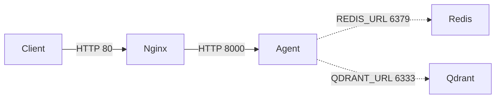

# Day 14 Lab — Mission Answers

## Part 1 — Localhost vs Production

### Exercise 1.1–1.2

Các anti-pattern trong `01-localhost-vs-production/develop/app.py`:

1. `OPENAI_API_KEY` đặt trong mã nguồn. Nếu đó là key thật, người có quyền đọc repo và lịch sử Git có thể dùng key.
2. Handler còn in key qua `print`. Bất kỳ nơi nào thu stdout cũng có thể lưu lại key.
3. `port=8000` cố định. Một nền tảng cấp `PORT` khác sẽ không kết nối được đến tiến trình.
4. `host="localhost"` chỉ nhận kết nối trên loopback. Proxy bên ngoài tiến trình hoặc container không thể gọi ứng dụng qua địa chỉ mạng của nó.
5. `reload=True` tạo tiến trình theo dõi file và có thể khởi động lại ứng dụng khi source thay đổi. Production cần khởi động lại có kiểm soát.
6. Chỉ có `/` và `/ask`. Hạ tầng thiếu probe riêng để phân biệt tiến trình còn sống và ứng dụng có thể nhận traffic.
7. Không có lifecycle cho tài nguyên ứng dụng. Khi triển khai thêm kết nối hoặc tác vụ nền, cần một chỗ rõ ràng để dọn chúng lúc tắt.

### Exercise 1.3

| Hạng mục | Develop | Production | Tại sao quan trọng |
|---|---|---|---|
| Cấu hình | Hằng số trong mã | Settings đọc env | Mỗi môi trường có thể đặt port và cấu hình riêng từ bên ngoài image. |
| Probe | Không có probe riêng | `/health` và `/ready` | Hạ tầng có thể nhận biết nên khởi động lại tiến trình hay chỉ ngừng gửi traffic. |
| Logging | `print` câu hỏi, key và câu trả lời | Log có trường sự kiện, không ghi key | Hệ thống tập trung dễ lọc sự kiện và ít làm lộ dữ liệu nhạy cảm. |
| Shutdown | Dựa vào shutdown mặc định của server | FastAPI lifespan ghi nhận startup/shutdown | Lifecycle cho phép dọn tài nguyên khi server ngừng nhận traffic và kết thúc request đang chạy. |

### Kết quả gọi local

Develop — POST /ask?question=Hello

```text
HTTP/1.1 200 OK
{"answer":"Agent đang hoạt động tốt! (mock response) Hỏi thêm câu hỏi đi nhé."}
```

Production — GET /health

```text
HTTP/1.1 200 OK
{"status":"ok","uptime_seconds":0.5,"version":"1.0.0","environment":"development","timestamp":"2026-11-25T08:42:52.278866+00:00"}
```

## Part 2 — Docker

1. Base image develop là `python:3.11` và thư mục làm việc là `/app`.
2. `COPY requirements.txt` đứng trước source code để layer `pip install` được tái sử dụng khi chỉ thay đổi code.
3. `ENTRYPOINT` chỉ định chương trình khởi động container. `CMD` cung cấp lệnh mặc định hoặc đối số mặc định cho `ENTRYPOINT`. Đối số sau tên image trong `docker run` thay `CMD`.
4. Stage builder của Dockerfile production cài dependency. Stage runtime dùng base slim, lấy dependency đã cài cùng source cần chạy và chạy với user riêng.

Luồng Compose: client → Nginx cổng 80 → agent. Mạng nội bộ của Compose kết nối agent với Redis (cache) và Qdrant (vector store). Mock LLM cho phép gọi ví dụ ngay cả khi không cấu hình dịch vụ LLM bên ngoài.



### Kết quả Docker

Kích thước thực tế Docker Engine báo cho các image đã build.

```text
k5-day14-agent:develop 426MB
k5-day14-agent:advanced 240MB
```

Image production nhỏ hơn 43.75% theo byte lấy trực tiếp từ Docker Engine.

Container develop.

```text
HTTP/1.1 200 OK
date: Wed, 25 Nov 2026 08:47:32 GMT
server: uvicorn
content-length: 126
content-type: application/json

{"answer":"Đây là câu trả lời từ AI agent (mock). Trong production, đây sẽ là response từ OpenAI/Anthropic."}
```

Qua Nginx cổng 80.

```text
HTTP/1.1 200 OK
Server: nginx
Date: Wed, 25 Nov 2026 08:47:55 GMT
Content-Type: application/json
Content-Length: 95
Connection: keep-alive
X-Frame-Options: DENY
X-Content-Type-Options: nosniff
X-XSS-Protection: 1; mode=block

{"status":"ok","uptime_seconds":0.2,"version":"2.0.0","timestamp":"2026-11-25T08:47:55.489479"}

HTTP/1.1 200 OK
Server: nginx
Date: Wed, 25 Nov 2026 08:47:55 GMT
Content-Type: application/json
Content-Length: 95
Connection: keep-alive
X-Frame-Options: DENY
X-Content-Type-Options: nosniff
X-XSS-Protection: 1; mode=block

{"answer":"Agent đang hoạt động tốt! (mock response) Hỏi thêm câu hỏi đi nhé."}
```

## Part 3 — Cloud Deployment

`railway.toml` của Part 6 chọn Dockerfile và `/health`. Blueprint Render mô tả cả web service Docker và Key Value trong YAML. `envVars` tạo API key và tham chiếu URL Redis nội bộ. Cả hai tài nguyên dùng gói Free. Agent đã chạy trên Render và các kết quả HTTP đã kiểm tra được ghi trong `DEPLOYMENT.md`. [URL public](https://day14-agent-6vy4.onrender.com/health)

### Exercise 3.3 — Cloud Run

1. `cloudbuild.yaml` cài dependency và chạy pytest trước khi build.
2. Image được gắn tag commit và `latest`, sau đó đẩy lên registry. Cloud Run deploy image gắn tag commit ở `asia-southeast1`.
3. `service.yaml` là manifest cho service với cổng 8000, concurrency 80, vùng scale 1–10 instance và probe `/health`, `/ready`.
4. Manifest khai báo key qua Secret Manager. Cấu hình tài nguyên và timeout giới hạn chi phí và thời gian xử lý request.

## Part 4 — API Security

Develop kiểm tra `X-API-Key` qua dependency của handler `/ask`. Thiếu hoặc sai key trả 401. Khi xoay key, cập nhật giá trị trong cấu hình triển khai, cập nhật client và nạp lại cấu hình ứng dụng.

Production phát JWT qua `/auth/token` sau khi kiểm tra thông tin đăng nhập. `/ask` xác minh chữ ký và hạn token rồi dùng danh tính, vai trò để chọn giới hạn. Sliding window giữ thời điểm các request trong 60 giây. Tài khoản `student` có 10 request/phút và tier quản trị có hạn mức riêng 100 request/phút.

Rate limit bảo vệ năng lực xử lý theo thời gian. Cost guard chặn chi phí tích lũy ngay cả khi tốc độ gọi thấp. Với ngân sách tháng, dùng key Redis theo user và tháng UTC. Kiểm tra và giữ chỗ cho chi phí ước tính trong một thao tác nguyên tử, sau đó quyết toán chi phí thật. Key tháng mới bắt đầu từ 0, còn key tháng cũ có TTL để dọn dữ liệu.

### Phản hồi đo trên localhost

Tài khoản student nhận 10 phản hồi HTTP 200 và 10 phản hồi HTTP 429 trong 20 request liên tiếp.

```text
HTTP/1.1 401 Unauthorized
content-type: application/json
connection: close

{"detail":"Missing API key. Include header: X-API-Key: <your-key>"}
```

```text
HTTP/1.1 200 OK
content-type: application/json
connection: close

{"question":"Hello","answer":"Agent đang hoạt động tốt! (mock response) Hỏi thêm câu hỏi đi nhé."}
```

```text
HTTP/1.1 429 Too Many Requests
x-ratelimit-limit: 10
x-ratelimit-remaining: 0
x-ratelimit-reset: 1795596257
retry-after: 59
content-type: application/json
x-content-type-options: nosniff
x-frame-options: DENY
x-xss-protection: 1; mode=block
referrer-policy: strict-origin-when-cross-origin
connection: close

{"detail":{"error":"Rate limit exceeded","limit":10,"window_seconds":60,"retry_after_seconds":59}}
```

## Part 5 — Scaling & Reliability

`/health` cho biết tiến trình còn sống. `/ready` cho load balancer biết instance có thể nhận traffic. Graceful shutdown để server ngừng nhận request mới, cho request đang xử lý hoàn thành và dọn tài nguyên qua lifespan.

Nếu session nằm trong RAM từng worker, request sau qua Nginx có thể vào worker chưa từng thấy session. Redis cho các replica dùng chung history. Cùng `session_id` có thể tiếp tục cuộc hội thoại qua các replica khác nhau.

### Kết quả thử nghiệm

GET /health và GET /ready đều trả HTTP 200. Khi gửi SIGTERM lúc /ask đang chạy, request vẫn nhận HTTP 200.

Chạy script stateless trên 3 replica. Dùng cổng host 18080 để tránh trùng cổng 8080 của stack observability.

```text
Total requests: 5
Instances used: {'instance-d8d939', 'instance-f93048', 'instance-b1bd8b'}
✅ All requests served despite different instances!
Total messages: 10
✅ Session history preserved across all instances via Redis!
```

## Part 6 — Production-readiness

`/health` độc lập với Redis. `/ready` trả 503 khi Redis không ping được. Rate limit dùng Redis sorted set và thời gian của Redis. Cost guard giữ chỗ theo chi phí tối đa của mock và quyết toán bằng số từ làm ước tính token. Uvicorn nhận SIGTERM và hoàn tất request đang chạy trước khi FastAPI đóng kết nối Redis.

Script chấm đầy đủ chạy trong Ubuntu WSL2 với Docker và Redis. Image đo bởi script là 273 MB.

```text
📋 Checklist Deliverable
     ✅ Dockerfile (multi-stage, < 500 MB)
     ✅ docker-compose.yml (agent + redis)
     ✅ .dockerignore
     ✅ Health check endpoint (GET /health)
     ✅ Readiness endpoint (GET /ready)
     ✅ API Key authentication
     ✅ Rate limiting
     ✅ Cost guard
     ✅ Config từ environment variables
     ✅ Structured logging
     ✅ Graceful shutdown
     ✅ Public URL ready (Railway / Render config)
----------------------------------------------------------------
  Result: 12/12 tiêu chí đạt · 43/43 checks passed
  🎉 PASS 12/12 — PRODUCTION READY! Deploy nào!
```

### Mở rộng Part 6

- History theo `session_id` lưu trong Redis. Khi gọi `/ask` và `/ask/stream` qua các replica khác nhau, `GET /sessions/{session_id}` trả đủ hai lượt của cùng phiên.
- `/ask/stream` trả `text/plain`. Lần kiểm tra qua Nginx nhận được 16 đoạn của câu trả lời mock. Request thiếu key trả HTTP 401.
- Nginx đã chuyển request đến đủ 3 replica theo `X-Served-By`. Sơ đồ chạy local và lệnh kiểm tra nằm trong [README Part 6](06-lab-complete/README.md#mở-rộng-part-6--history-streaming-và-nginx).

## AI log

- Yêu cầu Codex đọc hướng dẫn, cấu hình môi trường chạy lab, triển khai Part 6 và thực hiện benchmark. Codex viết bản triển khai, nháp câu trả lời và chạy các phép thử có ghi lại kết quả. Ở Part 7, Codex bổ sung histogram và hai mục kiến thức, rồi sửa `PYTHONUSERBASE` trong Dockerfile để runtime tìm được packages đã cài. Codex triển khai và kiểm tra thêm history Redis, streaming và Nginx 3 replica cho phần mở rộng Part 6.
- Học viên triển khai agent trên Render và tự chạy bốn lệnh `curl` trên Ubuntu WSL. Kết quả lần lượt là HTTP 200, 200, 401 và 200.
